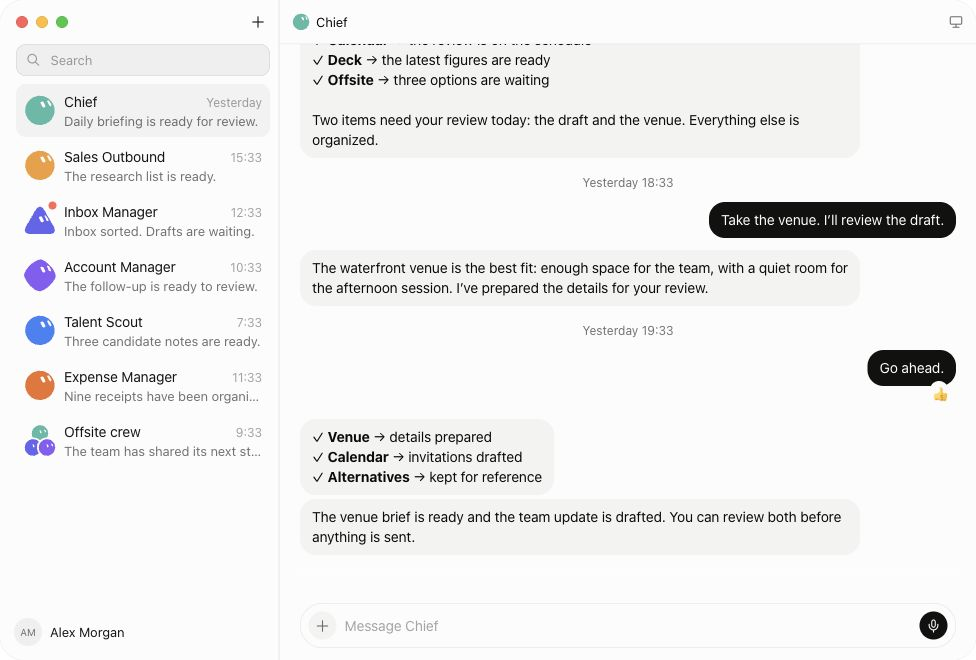

# Grok Bot UI / UX Kit

Grok Bot **0.68.1** 的 UI / UX 复刻资料仓库：视觉变量、组件尺寸、交互规格、原始素材、源码证据与可运行的 Web 参考。用途是把这套界面移植到另一个项目，按规格实现并逐项验收。

来源为用户提供的 `Grok_Bot_0.68.1.dmg`，使用 [REA](https://github.com/morluto/rea) 拆包与静态分析，再定向阅读 renderer 的 CSS / JavaScript。**未运行原应用、未登录、未取得原应用截图。** 另按用户指定的 [官网产品演示](https://x.ai/bot) 补充真实网页截图、CSS、头像与布局对照。根入口已按官网画面修正；[来源差异](docs/website-comparison.md) 明确区分官网演示与安装包。

## 立即使用

需要 Node.js 24 与 Python 3。预构建页面可直接运行；重新构建和测试头像需要 npm ci 安装锁定的 React、esbuild 与测试依赖，没有后端。

```sh
git clone https://github.com/xingyingyuzhui/grok-bot-ui-ux-kit.git
cd grok-bot-ui-ux-kit
npm ci
npm run check
npm run dev
```

打开 `http://127.0.0.1:8766/`。不要直接用 `file://` 打开：组件示例通过 HTTP 读取图标映射。

| 入口 | 内容 |
|---|---|
| [官网风格产品预览](index.html) | 动态彩色Bot头像、两行聊天列表、紧凑标题栏、胶囊输入区、可切换官网/DMG视觉来源 |
| [动态头像画廊](examples/avatar-motion.html) | 六个 Bot 的原动画、35 状态、25 轮廓、暂停、转身与形变 |
| [设计变量参考](examples/design-tokens.html) | 浅/深主题、136 个语义 token、字体与结构示意 |
| [组件行为示例](examples/workbench.html) | Bot 切换、侧边栏调整、输入、附件、发送状态、模拟语音、设置与线程分区 |
| [原始素材画廊](examples/asset-gallery.html) | 808 个图标名称与 outline/filled 字形、图片、字体和音频 |

GitHub 上的 HTML 链接显示源码；运行本地服务后才能交互预览。页面和生成文件已提交，修改 token 或画廊生成器后执行 `npm run build`。

## 复刻阅读顺序

1. 先读 [动态头像接入](docs/avatar-animation.md) 和 [官网画面对照](docs/website-comparison.md)，再读 [跨项目接入指南](docs/integration.md)：复制哪些文件、主题 API、组件契约、移植步骤。
2. [视觉系统](docs/visual-system.md)：配色、字体条件分支、排版、间距、圆角、动效。
3. [组件规格](docs/component-spec.md)：按钮、输入框、消息、任务卡、菜单、设置和浮动板。
4. [完整交互规格](docs/ui-ux-spec.md)：导航、布局公式、状态机、附件、消息动作、18 项快捷键及宿主接口边界。
5. [素材使用说明](docs/assets.md) 与 [图标说明](docs/icons.md)：原资源、名称映射、路径与渲染方式。
6. [83 项复刻验收清单](docs/replication-checklist.md) 与 [运行观察计划](docs/capture-plan.md)：把实现完成与原版一致性验证分开。

## 已整理的内容

- 浅色/深色各 **136 个 Sand 语义 token**，含原表达式、来源文件、字符偏移和 SHA-256。
- **808 个原始图标名称**：808 个 outline 字形、392 个独立 filled 字形，其余按原解析规则回退。
- 官网原动态头像组件：35 状态、25 轮廓、眨眼/表情节奏与形变；另附 DMG 53 状态的数学动画引擎。
- 官网观察CSS、组件尺寸、真实网页截图与7份静态头像快照，单独记录来源。
- **53 份原静态素材**：22 份字体、22 份图片、5 份音频、4 份样式；素材逐文件校验。
- 主聊天、Bot 导航、详情、任务线程、设置和桌面浮动板的静态规格与边界行为。
- 框架无关的主题/输入适配器、CSS 参考、TypeScript 声明、可交互工作台。
- 原 renderer、UI preload、3 份压缩 REA Evidence、完整参考文件哈希清单。



[动态头像接入说明](docs/avatar-animation.md)包含原组件、状态表和移植接口；截图是静态帧，真实动画请打开 Motion 页面。

截图是本仓库实现；[官网真实画面对照](docs/screenshots/official-website-product.jpg)与[来源说明](docs/website-comparison.md)可核对。

| 目录 | 用法 |
|---|---|
| `docs/` | 中文使用说明、行为规格、验收与证据定位 |
| `tokens/` | 可移植 JSON、CSS 主题、JS 主题映射 |
| `assets/` | 分类素材、图标映射、素材哈希清单 |
| `src/` / `dist/` | 参考适配器、可溯源的原头像子集与独立浏览器运行包 |
| `examples/` | 产品预览、设计变量、工作台、素材画廊 |
| `reference/` | 原 renderer/preload、独立官网CSS/观察，只作来源参考 |
| `evidence/` | 原始分析记录的 gzip 与校验清单 |
| `scripts/` / `tests/` | 生成、完整性检查与关键输入/主题测试 |

## 示例覆盖与差异

主产品页按官网演示修正，工作台展示主布局、主题、基础组件和部分交互分支。附件只暂存文件名、不上传；语音只模拟状态；消息结果由选择器控制；电脑/教学展示接入点；窄窗口线程弹窗是 Web 示例的适配选择。示例不包含真实 Agent、账户、支付、电脑连接、更新、原始富文本编辑器、全部消息类型或原桌面浮动板。

精确布局以规格为准：侧边栏默认 **280px**、范围 **240–400px**、折叠 **88px**；任务线程并排要求**主内容可用宽度至少 848px**，不能直接当作 viewport 断点。功能开关、登录后数据、真实窗口与头像以外的完整动效仍需要运行观察。REA 关系图 coverage 为 partial，不能称为完整语义恢复。

[分析过程与证据边界](docs/provenance.md) 记录 ASAR 完整性差异及分析覆盖；[NOTICE](NOTICE.md) 记录原材料来源和权利归属。公开仓库不改变原材料的授权状态。

## 检查与更新

```sh
npm ci
npm run build
npm run check
```

检查素材与原参考文件 SHA-256、136 个 token 源码锚点、证据解压哈希、图标数量、文档链接、JS 语法和关键输入/主题状态。它们验证本仓库的可用性与溯源，不证明原应用运行行为完全一致。[实际验证记录](docs/validation.md)列出浏览器操作结果。

将本仓库交给另一个编码 Agent 时，先读 [AGENTS.md](AGENTS.md)，再读接入指南与验收清单。需要运行截图时按照观察计划补齐，不把参考页截图当原版截图。
