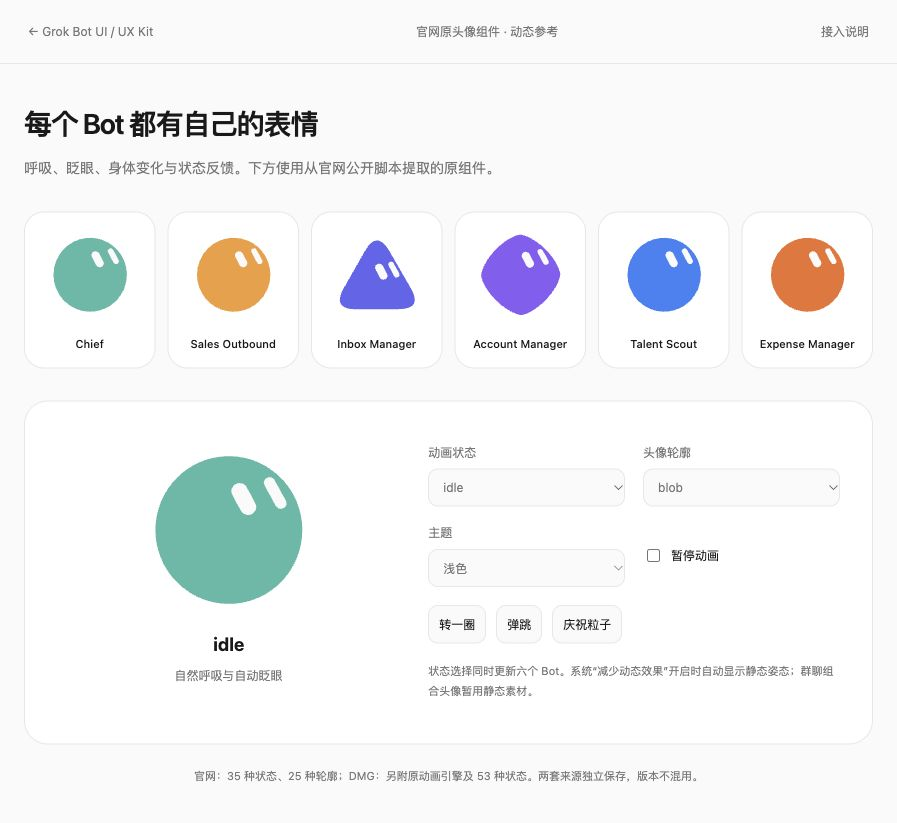

# 动态头像与跨项目接入

此前主预览中的头像是官网 DOM 的单帧 SVG 快照，**没有动画**。现在六个独立 Bot 和当前聊天标题使用从官网公开脚本恢复的原动画组件，动态改变 SVG 路径、眼睛、身体姿态与形变；不是给静态图片添加 CSS 摇摆。

[动态头像画廊](../examples/avatar-motion.html) 可切换全部 35 种官网状态、25 种轮廓，并触发转身、弹跳与庆祝粒子。[主产品预览](../index.html) 默认循环 idle 动画；Appearance → Avatar animation 可关闭。系统减少动态效果、页面隐藏、头像离开视口时，适配器卸载动画组件，显示静态姿态并取消 RAF；恢复时重新启动，因此时间相位会重置。这是本仓库的节能适配选择。



## 两套来源

| 来源 | 内容 | 用途 |
|---|---|---|
| 官网 2026-10-11 | 原 React 动画组件、几何数据、眨眼/表情节奏、静态组件；35 状态、25 轮廓 | 当前主预览和动态画廊，复刻官网展示 |
| DMG 0.68.1 | 独立数学动画引擎、clip 调度、SVG renderer；53 状态 | 对照原安装包、框架无关的底层接入 |

官网版本未公开，不能把两套状态、形状或动画时序互相替换。DMG 的 `failed`、`finished`、`waiting`、`streaming` 不属于官网 35 状态；官网适配器会拒绝未知状态，避免静默冒充。原完整应用没有启动或登录；本次在独立参考环境执行的是经过静态筛选的动画子集。

官网页面中 Chief / Sales / Talent / Expense 使用 `blob`；Inbox 使用 `wedge`，Account 使用 `gem`。颜色来自已观察的官网值。原素材中的 SVG 捕获于某一时刻，可能处在轮廓过渡帧，不能据此推断 Bot 总是圆形。群组三头像在本仓库仍保留观察到的静态组合，不声称已经恢复群聊的全部动态行为。

## 最小接入：HTML、Vue、Svelte 或其他框架

复制预构建的 [dist/avatar.js](../dist/avatar.js)、[src/avatar.css](../src/avatar.css) 到目标项目。JS 已包含 React 运行时；通过 HTTP 提供文件即可，不需要 CDN、账号或后端。

```html
<link rel="stylesheet" href="./avatar.css">
<span id="avatar" aria-hidden="true"
  style="display:block;width:32px;height:32px;--fg:#54B9A6;--bg:#fcfcfc"></span>
<script type="module">
  import {mountAvatar} from './avatar.js';
  const avatar = mountAvatar(document.querySelector('#avatar'), {
    shape: 'blob', state: 'idle', seed: 1
  });
  // 接到任务状态时更新，而不是不断重新挂载。
  avatar.setState('thinking');
  // 页面或组件销毁时调用 avatar.destroy()。
</script>
```

`--fg` 是身体颜色，`--bg` 是眼睛颜色。深色切换时更新父级变量即可，不需要更换图片。侧栏用 32×32，标题用 18×18；尺寸由容器决定，SVG 保留官网 `viewBox="-15 -15 259 259"`。人物是装饰图形，Bot 名称仍由可访问的文字提供。

Vue 在 mounted 挂载并在 unmounted 调用 `destroy()`；Svelte 在 onMount 返回销毁函数。列表使用稳定 Bot ID，更新状态调用现有 controller，不要每帧重新创建实例。每次 mount 拥有独立 RAF / React root；组件销毁、隐藏和静态回退都会清理。

### 接口

| 接口 | 用法 |
|---|---|
| `mountAvatar(element, options)` | options：state=idle、shape=blob、seed=1、paused=false、followPointer=false |
| `setState(state)` | 35 个官网状态之一，平滑过渡 |
| `setShape(shape)` | 25 个官网轮廓之一，身体变形 |
| `setPaused(boolean)` | 切换静态姿态；不是冻结并缓存某一帧 |
| `spin(turns=1)` | 原组件转身；适配器限制 0 < turns ≤ 4 |
| `bounce()` / `burst()` | 原组件弹跳 / 庆祝粒子 |
| `snapshot()` | 当前独立 SVG 字符串，可供导出；是一个静态帧 |
| `destroy()` | 取消 RAF，清除 DOM、媒体偏好与 pointer 监听；可重复调用 |
| `avatarStates` / `avatarShapes` | 状态 / 轮廓列表 |
| `avatarPresentation(state, shape)` | 恢复官网展示层的眼睛参数与姿态，用于原 React 组件接入 |

眨眼是原引擎自动调度的。官网原组件的 ref 没有 `blink()`；不要把 DMG 引擎的 blink 接口误接到官网组件。`seed=1` 保持官网组件默认值；改变种子会改变随机表情节奏。followPointer 是可选本地增强，主产品页默认关闭，画廊的放大头像开启。

## React 原组件接入

目标项目已使用 React 时，可通过本地包或复制 `src/website-avatar*.generated.js` 与 `src/avatar.js` 接入，安装锁定依赖，避免使用多个不同 React 副本。直接组件示例：

```jsx
import {GrokBot} from './grok-kit/src/website-avatar.generated.js';
import {avatarPresentation} from './grok-kit/src/avatar.js';
import './grok-kit/src/avatar.css';

export function BotAvatar({state = 'idle', shape = 'blob', color}) {
  return <span aria-hidden="true" style={{display:'block',width:32,height:32,
      '--fg':color,'--bg':'var(--surface)'}}>
    <GrokBot {...avatarPresentation(state, shape)} state={state} shape={shape}/>
  </span>;
}
```

直接使用原组件时，暂停、隐藏与减少动态效果的生命周期由你的项目处理；可使用本仓库 mountAvatar 适配器作为参考。原 still renderer 支持 18 种轮廓；适配器从官网 live 几何表补入剩余 7 种，保证任一画廊轮廓进入静态回退时不会报错。

## 官网状态与节奏

完整参数表在 [catalog.json](../assets/avatar-motion/catalog.json)：每种状态的眨眼区间、表情区间、表情池编号与一次形变时间。以下时间来自原公开代码，不是估计值。

| 状态组 | 状态 |
|---|---|
| 生命周期 | sleeping, waking, idle, listening, thinking, searching, working |
| 情绪 | excited, surprised, suspicious, angry, drowsy, happy, curious, confused, bored, proud, shy, sad, laughing, scared, playful, celebrate |
| Agent 形变 | orbit, radar, progress |
| 产品生命周期 | spawning, humming, dictating, writing, sending, receiving, uploading, alerting, powering-down |

idle 眨眼随机间隔为 **6–14 秒**，表情变化为 **9–16 秒**；listening 为 **3–7 秒**眨眼；working 为 **2.8–5.5 秒**。一些形变态与 sleeping 没有常规眨眼计时。progress 展示 2500ms、spawning 展示 2000ms，形变休息间隔 1500ms。帧时间最大步长 0.1 秒，内部弹簧步长 1/120 秒；种子生成随机调度，而非固定序列图。

thinking 形变为 dots；orbit、radar、progress 分别使用轨道/雷达/进度；dictating 使用 wave；sending/receiving 使用 send/receive；uploading 使用 dock；writing 使用 pencil；alerting 使用 bang；powering-down 使用 standby。

原官网展示姿态 turn=17、tilt=-14、roll=29。blob 基础 scale=0.92×259/229，wedge=0.94×259/229，gem=1×259/229；eyeTopology、uniformEyes、naturalLids 开启。不能仅复制通用组件的默认值，否则眼睛和整体比例会与官网不同。

主产品页的模拟发送映射为 sent→happy、queued→working、failed→confused，模拟语音为 listening→dictating→idle；重试更新本地反馈。**这些业务事件映射是本仓库的示例选择**，不是已验证的原应用服务状态机。真实项目应根据自己的任务阶段设状态。

## DMG 的框架无关引擎

[avatar-engine.generated.js](../src/avatar-engine.generated.js) 是从 platform 模块静态挑选的 633 个声明，约 170KB。没有原 React 组件、IPC、网络、登录或应用启动逻辑。提取时按词法作用域追踪依赖，未发现 import；所用全局只包括数学、数组、Map/Set、类型化数组等。`updateSVG` 接收你提供的 DOM 容器，做原 SVG 属性增量更新。

```js
import {createMotion,createBehavior,createPaint,renderMotionSVG,
        hashSeed,resolveBody,fillScale,defaultFill,updateSVG}
  from './avatar-engine.generated.js';
const motion = createMotion({body:resolveBody('blob')});
const behavior = createBehavior(motion, 'idle', {
  seed:hashSeed('stable-bot-id'), isCompact:true
});
const paint = createPaint('var(--fg)', 'var(--bg)');
let last = performance.now(), raf;
function frame(now) {
  const dt = Math.min((now-last)/1000, .1); last = now;
  behavior.advance(dt); motion.advance(dt);
  updateSVG(container,renderMotionSVG(motion.frame(),paint,192,'unique-avatar',
    {displaySize:32,extent:'100%'}));
  raf = requestAnimationFrame(frame);
}
raf = requestAnimationFrame(frame);
// behavior.setState('thinking'); motion.blink(); motion.poke('spin');
// 销毁时 cancelAnimationFrame(raf)。
```

`container` 是外层 32px 容器中居中的绝对定位子层，其宽高为 `fillScale(defaultFill)*100%`（153.3333%），left/top=50%，transform=translate(-50%,-50%)，pointer-events=none。默认 fill=0.92；不补这层尺寸关系会导致头像过小。SVG ID 对每个容器必须唯一。

`createMotion` 提供 load/play/pause/seek/setBody/setMorph/setExpression/blink/poke/setGaze/look/advance/frame 等底层操作；`createBehavior` 提供 setState/setCompact/setEmphasis/setResting/advance。先推进 behavior，再推进 motion。DMG 小于48px 使用 compact clips；idle 紧凑模式只用 Idle_B，较大模式从 Idle_B/Idle_D/Idle_A 组合中调度。finished 完成后回 idle；failed 用 Blocked_B 后回 idle；blocked 用 Blocked_A 后进入 drowsy。完整 53 状态的 clips、face、morph、next、holdSeconds 在 catalog 的 dmg.states。

## 溯源与复现

[官网提取清单](../assets/avatar-motion/website-extraction.json) 保存完整公开源文件 URL/SHA-256、每个语句的原范围与改写规则。处理只去掉遥测、把 Turbopack 模块 import/export 接到本地 ESM，动画函数保留。公开原文件在 [reference/website/motion](../reference/website/motion/)。展示层参数由对应 wrapper 定向恢复。

零基 Unicode 字符锚点：

- 官网 `2x3dmgtyfwu26.js`：40042 是 GrokBot forwardRef；68575 是 RAF 入口附近。
- 官网 `2az6pe2uqwg5f.js`：23763 是 idle 眨眼区间；26581 是展示姿态与参数；28049 是展示 wrapper。
- 官网 `2qxgawzx_hxyu.js`：788 是 AgentAvatar；57505 是 Inbox 的 wedge，58925 是 Account 的 gem。
- DMG `index.eager-platform-AatQIEPx.js`：329200=createMotion、378000=状态表、380526=behavior、479462=SVG renderer、479774=DOM updater、484613=形状别名、484788=paint。

提取 manifest 的 start/end 则使用 AST 的 **UTF-16 code unit** 范围，同时附 charOffset；二者不能直接混用。[DMG 提取清单](../assets/avatar-motion/dmg-extraction.json) 保存词法依赖闭包及每段 SHA-256。`npm ci && npm run build && npm run check` 可重建并校验全部生成结果。

自动测试推进原组件的受控 RAF，验证连续变化、眼睛变化、35 状态与25 轮廓的有限几何值、thinking 粒子、暂停/减少动态效果与销毁清理，并检验 DMG 53 状态和相同种子的可重复性。浏览器观察见 [validation](validation.md)。这些检查支持独立头像子集可运行，不证明原 App 全流程或官网所有演示场景完全一致。原素材权利归属仍见 [NOTICE](../NOTICE.md)。
