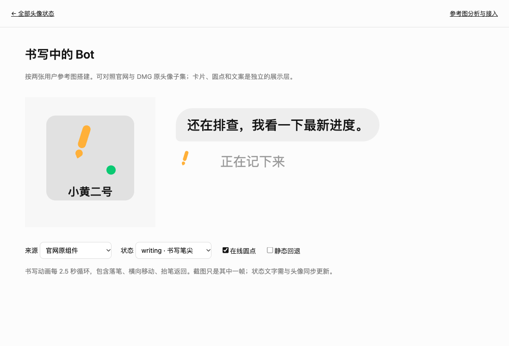
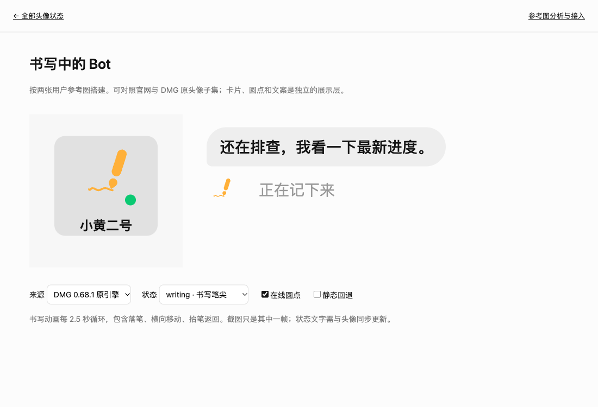

# 两张参考图的头像差异与复现

2026-10-11 用户补充了 Bot 卡片和聊天状态两张截图。它们显示同一种倾斜的橙色书写图形。截图没有包含来源版本或动画全程，下面区分截图观察、原代码事实与示例选择。

## 结论

两张图的轮廓与原组件的 **writing → pencil** 相符，不应按 **alerting → bang** 接入。最初仅凭外观称它为感叹号的判断已更正。

| 项目 | writing / pencil | alerting / bang |
|---|---|---|
| 上部 | 等宽圆头笔杆，倾斜约 17° | 上粗下细的直立提醒条 |
| 下部 | 原头像缩成小水滴笔尖 | 原头像缩成圆点 |
| 眼睛 | 完整形变阶段隐藏 | 完整形变阶段隐藏 |
| 运动 | 横向书写、抬笔返回、可出现墨迹 | 周期性衰减抖动 |
| 状态文案 | 由业务展示层提供 | 由业务展示层提供 |

**这不是眼睛或身体遮罩丢失。** 隐藏眼睛、把身体缩成笔尖是原动画的分支。不要通过强制显示眼睛、替换为 emoji、给普通圆头像加 CSS rotate 来修正。

绿色圆点是截图中的独立状态装饰，不能算作笔尖、眼睛或动画粒子。截图无法证明它在原产品的全部业务含义；本示例把它作为可单独切换的在线圆点。

## 可运行参考

运行 `npm run dev`，打开 [书写头像参考](../examples/writing-avatar.html)，地址是 `http://127.0.0.1:8766/examples/writing-avatar.html`。

- 卡片：190×184，圆角20；头像容器144×144；独立圆点20×20。
- 聊天：头像容器54×54；文字「正在记下来」；状态与头像同时更新。
- 可切换 writing / alerting / thinking / idle，直观看出笔尖、提醒与普通头像的区别。
- 可单独关闭圆点或使用静态回退。静态回退按现有适配器显示普通头像，不是冻结书写帧。
- 来源选择器可对照官网组件与 DMG 0.68.1 数学引擎。切换来源会销毁旧实例、重置相位；DMG 演示适配器见 [dmg-avatar.js](../examples/dmg-avatar.js)，它不是原 React 宿主组件。

这些尺寸是针对截图的示例选择，截图像素不能直接证明原应用的 CSS 逻辑尺寸或缩放倍率。示例没有改变原动画曲线，也没有把某一个截图位置固定为每一帧的头像位置。





## 一个已经复现的实际差异：墨迹依赖帧率

官网组件按每次 RAF 保存笔尖点：距离上一个点超过2.4时追加，否则替换最后一个点。在较高帧率下，每帧位移较小，连续替换可能使轨迹始终只有一个点，墨迹不显示。DMG 则预计算落笔路径，按状态时间取样，最后保留最多64点；抬笔时按时间擦除，不依赖每次 RAF 是否超过采样间距。

对原官网组件做受控 RAF 实验，均从 writing 启动并推进5秒：

| 帧率 | 墨迹可见帧数 | 最长墨迹路径字符串 |
|---|---:|---:|
| 60 FPS | 0 / 300 | 0字符 |
| 30 FPS | 110 / 150 | 1101字符 |

复现命令：`node scripts/probe-avatar-ink.js`。这是 JSDOM 中原组件的受控实验，不能直接当作真实机器实测帧率。本轮 Chromium 的官网子集示例也经常只见笔杆和笔尖，而 DMG 示例已观察到连续墨迹。

相关原代码：官网查找 `Math.hypot(t-a[0],e-a[1])>2.4` 与 `a&&(a[0]=t,a[1]=e)`；DMG 原 platform 文件零基字符469465 `Ua=`、469984 `nM=`、470192 `rM=`。

**移植选择**：若目标是按 DMG 0.68.1 恢复稳定书写轨迹，使用 DMG 引擎对照；若目标是当前官网展示，保留官网组件的行为。修正官网采样规则属于目标项目自主修复，不应改写本仓库的原材料或把修复称为原版已验证。

### 配色

两张 PNG 都嵌有 ICC 色彩配置。将像素转换到 sRGB 后，橙色主色约为 `#FFB039`，第一张圆点约为 `#0AC972`；卡片背景 `#E1E1E1`，外部背景 `#F7F7F7`；第二张背景 `#FCFCFC`、气泡 `#EEEEEE`。如果直接读取未经转换的 PNG 像素，会得到另一组数值。

这些值来源于用户截图，**不是** 官网预设颜色。官网 Sales 的 `#F19D38`、Expense 的 `#ED712E` 不需要因此改动。

## 可复制的接入

```html
<link rel="stylesheet" href="./avatar.css">
<div style="position:relative;width:144px;height:144px">
  <span id="bot-avatar" aria-hidden="true"
    style="display:block;width:100%;height:100%;--fg:#ffb039;--bg:#e1e1e1"></span>
  <!-- 在线圆点单独放置，不插入引擎生成的 SVG。 -->
</div>
<span id="bot-activity" role="status">正在记下来</span>
<script type="module">
  import {mountAvatar} from './avatar.js';
  const avatar = mountAvatar(document.querySelector('#bot-avatar'), {
    state: 'writing', shape: 'blob', seed: 1
  });
  function updateActivity(state, label) {
    avatar.setState(state);
    document.querySelector('#bot-activity').textContent = label;
  }
  // 开始书写：updateActivity('writing', '正在记下来');
  // 结束书写：updateActivity('idle', '准备好了');
  // 组件卸载时 avatar.destroy()。
</script>
```

聊天中的小头像改容器宽高即可。原引擎会按实际显示宽度调整形变 viewBox；不应把大头像的一帧导出后无限缩小，也不要固定覆盖每帧 viewBox。保持 SVG `overflow:visible`，不要在紧贴头像的父级加 overflow:hidden，否则笔杆、笔尖、轨迹或粒子可能被裁掉。

业务状态与表情必须分别接入。普通的后台工作不等于一直书写；没有后端事件时，不能仅凭「Bot 正在工作」就认定原产品此时使用 writing。当前主产品页的发送结果映射仍是本仓库模拟，用户截图的文案不证明原服务状态机。

## 动画与源码证据

官网原动画与 DMG 数学引擎都包含 pencil 分支，但两套渲染器和全部状态集合不能互换。

| 代码事实 | 来源与定位 |
|---|---|
| 官网 writing→pencil、alerting→bang | `reference/website/motion/2x3dmgtyfwu26.js`，查找 `writing:"pencil",alerting:"bang"` |
| 笔杆宽30、高88，两个半径15的圆头 | 同文件，查找 `HEAD_C-44+15`；DMG `US=GS(30,88)` |
| 书写周期2500ms，前68%落笔、后32%抬笔返回 | 官网查找 `e/2500%1` 与 `r<.68`；DMG `Xs=2500,hr=.68` |
| 位移从 -54 到64，基础角17°；抬笔阶段有高度变化 | 官网查找 `x:-54`；DMG 查找 `Ua=` |
| 笔迹采样最小距离2.4、最多64点，曲线描边宽6 | 官网查找 `t9.length>64` 与 `stroke-width","6"` |
| DMG 笔尖形状与提醒圆点分开 | `reference/renderer/assets/index.eager-platform-AatQIEPx.js`，零基字符468323 `Wl=hh(88,18).ring`；473389 `pencil.shaft` |

精确字符偏移可用文本搜索重新取得，不将生成文件偏移当成原源文件偏移。源码文件保持原字节，提取清单与哈希见 [动态头像说明](avatar-animation.md)。

## 此轮差异清单

| 差异 | 处理 / 边界 |
|---|---|
| 以前的预览默认 idle，看不到截图中的书写图形 | 增加专门的 writing 卡片 / 聊天示例 |
| 外观相似使 pencil 被误认为 bang | 增加双状态切换、结构说明和回归断言 |
| 官网默认色与用户橙色不同 | 单独使用截图色，不修改官网预设色 |
| 在线圆点被当成头像引擎的一部分 | 展示层单独渲染、可切换 |
| 只验证「SVG 在动」不足以支持外观一致 | 浏览器检查笔杆、笔尖、隐藏眼睛、小尺寸 viewBox 和完整循环 |
| 两张参考图只是静态帧 | 不宣称已证实原 App 全部时序或每帧像素一致 |
| 官网墨迹按帧采样，DMG按时间生成 | 保留两套实现，并提供来源选择与帧率探针 |

本轮也只读核对了 [官网](https://x.ai/bot) 当前渲染的 React 组件参数：idle 的 blob / wedge / gem 尺寸、姿态与眼睛参数和 `avatarPresentation` 一致。没有证据支持重新绘制基础形状或调整眼睛比例。官网鼠标跟随适用范围、页面演示序列与原 App 的任务驱动仍需分别验证。

## 验证记录

2026-10-11，Chromium 154.0.8037.99，本地 HTTP 服务：

- 桌面1100×750、移动端390×844，移动端 scrollWidth=390，无横向溢出；[移动截图](screenshots/writing-reference-mobile.png)。
- 官网 writing 笔杆连续移动、完整形变眼睛隐藏；切回 idle 眼睛恢复。alerting 切换为另一条提醒路径。
- 官网144px容器的稳定 viewBox为 `-15 -15 259 259`；54px容器自动调整为约 `3.91 3.91 221.18 221.18`，不能强制固定。
- DMG 的 writing / alerting / thinking / idle 均渲染，无 NaN / Infinity；writing 已观察到宽6的墨迹路径。
- 圆点独立切换；静态回退、系统减少动态效果和销毁后，待执行头像 RAF 都降为0。两个头像运行时为2，连续切换来源6次后仍为2。
- 页面控制台0错误、0警告；`npm run build` / `npm run check` 通过，7项自动测试通过，原材料哈希保持不变。

这些验证覆盖本页的独立头像与展示层，不证明原 App 的服务事件、全部动画分支或与用户截图每帧像素相同。
