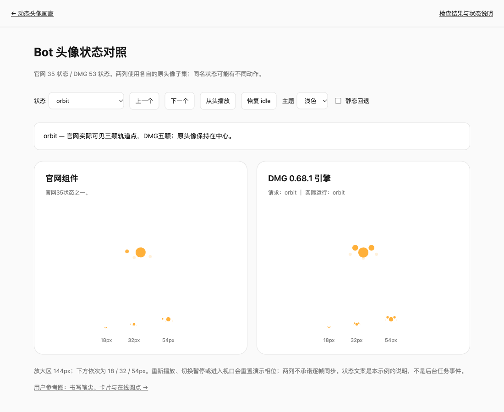
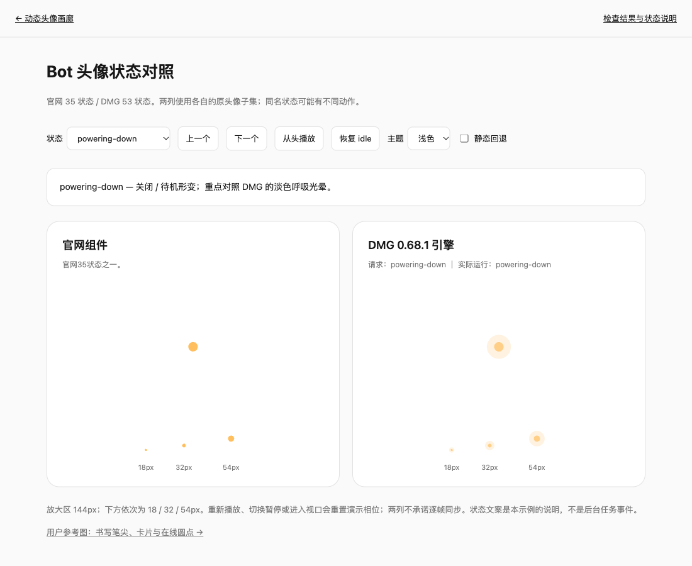

# 全部头像状态的检查与复刻说明

2026-10-11，继续对两套原头像子集逐项调查。官网 **35状态**、DMG 0.68.1 **53状态**全部推进、渲染并检查恢复；重点检查12类类似书写头像的形变。原源码、提取范围与哈希保持不变。下面所称「官网」是从官网公开脚本恢复的独立组件，「DMG」是安装包的独立数学引擎，均不等于已运行原App全流程。

[可运行双来源对照](../examples/avatar-states.html) · [完整53状态目录](avatar-state-catalog.md) · [机器检查数据](avatar-state-audit.json) · [浏览器观察数据](avatar-state-browser.json)

## 已确认的差异

### 1. orbit：官网3颗轨道点，DMG5颗

官网原代码的轨道分支遍历5颗粒子。但同一帧末尾，humming分支复用第4、5个circle节点；当humming权重为0时，仍把这两个节点设成display:none。因此独立官网组件实际只有3颗外围点。DMG的渲染器生成独立parts，保留5颗。

这不是小尺寸、颜色太淡或本仓库漏了素材。144px浏览器观察及18/32/54px受控检查均能复现。原官网程序的目标数量与最后实际显示数量应分别记录。



### 2. spawning：官网最后两颗生成粒子被隐藏

同样的节点复用也作用于spawning。官网生成分支本来计算5颗粒子，末尾隐藏最后两颗；DMG保留5颗，随阶段逐颗聚拢和消失。**单帧可见数量还取决于生成阶段**，不能要求任意截图始终有5颗。

### 3. powering-down：官网的淡色呼吸光晕被隐藏

官网standby分支设置第5个circle的半径和透明度，随后被上述humming分支隐藏。浏览器观察到该节点半径约27.8却display:none；DMG能看到淡色呼吸光晕。两版的中心主体仍在，不要把「没有光晕」判断成整个头像丢失。



### 4. 同名状态的行为不同

| 状态 | 官网原组件 | DMG数学引擎 |
|---|---|---|
| searching | 头像转动、搜索姿态与随机表情 | radar形变 |
| humming | 旋转的中心头像与2颗外围点 | Idle_B片段与calm表情；本数学子集无外围点 |
| waking | 保持请求的waking状态，内部动作随时间变化 | 1.6秒后behavior自动进入idle |
| idle / working / 情绪组 | 程序生成的姿态、眼睛弹簧和表情调度 | 预制动画clips＋face覆盖，部分clips有48px紧凑分支 |

DMG还有18个官网不支持的状态。waiting是orbit，loading是progress；reading / coding / running / computing / controlling使用working片段组；finished / failed / approving最终回idle，blocked在120秒后进入drowsy。完整字段见状态目录。不要靠状态名猜效果，不要把官网wrapper对loading / notifying等别名的映射与引擎原生状态混为一谈。

### 5. writing的帧率差异继续复现

本轮推进10秒：官网60 FPS时0帧有墨迹，30 FPS时220帧有墨迹。DMG按状态时间生成路径，已观察到稳定轨迹。细节见 [两张书写参考图分析](avatar-reference.md)。

**本轮没有重绘原组件或修改这些原分支。** 复刻官网时保留官网行为；复刻DMG时选择DMG引擎。若目标项目要修复官网的节点复用或墨迹采样，需要标注为自主修复，不能声称是原版原样恢复。

## 12类形变逐项说明

| 状态 / 形变 | 实际视觉结构 | 时序与接入注意事项 | 对照结论 |
|---|---|---|---|
| thinking / dots | 中央头像变成中间点，左右各一个点 | 左右点轮流抬升、缩放和变淡；完整形变隐藏眼睛 | 官网侧点用path，DMG侧点用circle；仅数circle会误判缺点 |
| orbit | 中央头像＋外围轨道点 | 深度改变点的半径和透明度；持续循环 | 官网3颗可见，DMG5颗 |
| radar | 中央头像＋3层扩散环 | 每1300ms一轮、三环错相；透明度随扩散衰减 | 两版均观察到三环；环位置不能按不同时间的截图直接比 |
| progress | 主体＋淡色轨道＋进度弧 | 形变展示2500ms、休息1500ms；再循环 | 两版均有形变与回到普通头像的阶段；不是永久固定100%圆环 |
| spawning / gather | 粒子向主体聚拢 | 展示2000ms、休息1500ms；各粒子错相 | 官网末两粒被隐藏，DMG保留五粒轨迹 |
| dictating / wave | 中央主体＋左右四个动态节点 | 幅度由时间函数驱动；不是接真实麦克风音量的演示 | 官网2个path＋2个circle，DMG4个circle；总节点数相同 |
| sending / send | 朝右上方移动的主粒子、尾随小粒子和淡出环 | 周期1500ms，多个元素有不同出现窗口 | 两版均可见；某帧只见一个点/没有波纹是正常阶段 |
| receiving / receive | 外侧点收拢到主体，再出现接收环 | 周期1700ms；入射方向有种子随机性 | 不应硬编码始终从同一方向进入，也不要求发送/接收互为镜像 |
| uploading / dock | 两颗点依次进入，再围绕主体运动 | 首点约0.2秒起，次点约1.5秒起，入场段约0.9秒 | 起始只有一个点是正常阶段；不是粒子数量少一颗 |
| writing / pencil | 倾斜圆头笔杆、主体缩成水滴笔尖、可见墨迹 | 2500ms，前68%落笔、后32%抬笔 | 官网墨迹按帧采样，DMG按时间采样 |
| alerting / bang | 直立上粗下细提醒条、主体缩成圆点 | 2.2秒周期的衰减抖动 | 不能当作writing或使用静态感叹号替代完整过程 |
| powering-down / standby | 缩小的中心主体、淡色呼吸光晕，入场有收缩环 | 持续呼吸；名称不表示动画会自行销毁组件 | 官网光晕被覆盖隐藏，DMG可见 |

完整形变阶段隐藏眼睛是原分支；progress/spawning休息阶段会恢复眼睛。主头像缩成点并不等于消失。视口、轨迹、粒子和身体缩放都由每帧共同决定，不能拿一张静态SVG覆盖动态viewBox。

## 尺寸、主题与恢复

对照页同时显示144px放大区和18/32/54px实例。官网以约259的逻辑viewBox开始，小尺寸形变自动收紧viewBox；DMG使用fill=0.92与153.3333%的居中子层、按displaySize调整形变缩放。二者的SVG数值坐标系不同，不能直接比较path数字或viewBox宽度。

DMG小于48px启用compact clips。这影响idle等片段调度，不表示所有形变的粒子数量都应该减少。自定义avatar外层保持overflow可见，避免笔杆、扩散环、飞出粒子被裁切。

本轮验证了12类形变→idle恢复：官网重新显示两个眼睛，glyph隐藏；DMG的morph清除，eyes恢复两个。静态回退与系统减少动态效果采用本仓库适配选择，显示普通头像并取消RAF；它们不是冻结原形变的某个截图。

DMG对照适配器现在保留CSS颜色变量，使浅深主题切换同时更新正在运行与静态回退的身体、眼睛和粒子；不再只在上一帧读一次固定颜色。对照页显示「请求状态」和「实际运行状态」，以区分finished等自动回idle的状态。

## 复现方法与检查范围

```sh
npm ci
node scripts/audit-avatar-states.js
node scripts/probe-avatar-ink.js
npm run build
npm run check
npm run dev
```

打开 `http://127.0.0.1:8766/examples/avatar-states.html`。选择状态，观察两列和四种尺寸；点「恢复idle」验证过渡；点「从头播放」重新观察入场；对官网没有的状态，左列明确显示「仅DMG支持」，不会静默改成idle。

受控检查使用JSDOM和原子集，官网按实际RAF步长推进；尺寸由getBoundingClientRect模拟。默认官网blob、DMG sphere，本轮不声称覆盖状态×全部25轮廓的组合。每例10秒、随后恢复idle观察2秒；采样时间为0.25/0.5/1/1.5/2/2.5/3/3.5/4/5/6/8/10秒：

| 检查集合 | 覆盖 | 结果 |
|---|---|---|
| 官网129例 | 35状态×32/144px 60FPS，35状态×32px 30FPS；12形变额外18/54px 60FPS | 无NaN/Infinity/undefined；所有采样序列有变化 |
| DMG424例 | 53状态×18/32/54/144px×30/60FPS | 无无效几何；所有采样序列有变化 |
| 状态恢复 | 12官网形变、所有DMG morph状态→idle | 恢复眼睛并清除形变 |
| 生命周期 | DMG finished/failed/approving/waking；blocked 119秒与121秒 | 前四者回idle；blocked前后分别blocked/drowsy |

两版的路径类型不同：JSON里的circle数量只统计可见circle，不包括path实现的圆点。DMG眼睛数量来自engine.frame().eyes，官网来自可见eye路径。因此这些数量用于逐来源定位，不能直接当成像素相等的证明。

浏览器使用Playwright（本会话未提供Browser插件），Chromium154，本地HTTP；桌面1100×900、移动390×844。检查页面身份、非空内容、无错误浮层、控制台、截图、选择状态、恢复、主题和静态回退。实际浏览器逐状态检查与移动/主题结果见 [浏览器数据](avatar-state-browser.json)。截图是本仓库子集，不是原App截图。

[浅深主题截图](screenshots/avatar-state-dark.png)与[移动长截图](screenshots/avatar-state-mobile.png)记录布局。移动长截图中未进入视口的DMG列标为「静态回退」，此时显示普通头像；不能把它当作powering-down本身的动画差异。滚动进入视口后会重新播放。浏览器53个状态入口检查、14种重点状态观察、0控制台错误/警告与8项自动测试通过；连续切换8次后保持8个RAF和1个状态刷新定时器，页面销毁降为0/0，返回页面后恢复8/1；选项逐一检查不是逐帧录像。

**边界**：10秒不能覆盖每种长期随机表情或全部clip周期；blocked的120秒单独用受控测试验证。未运行原App、未接真实任务/音频/网络事件、未验证Safari或Electron。仍需按目标项目实际业务事件驱动状态，并结合更长运行录像验收。

## 原代码定位

零基Unicode字符偏移，原文件不是生成文件：

| 文件 | 偏移 / 可搜索锚点 | 事实 |
|---|---|---|
| `reference/website/motion/2x3dmgtyfwu26.js` | 51761，`for(let t=0;t<5;t++){let e=tB.current[t]` | orbit设置5个circle |
| 同上 | 53139，`eZ=(t,e)` | spawning生成分支 |
| 同上 | 58884，`e5=(t,e)` | standby设置光晕 |
| 同上 | 67877，`let ei=E(t7.x` | humming分支覆盖第4、5个circle的可见性 |
| 同上 | 53620，`eJ=(t,e)` | 波形四节点采用path与circle混合 |
| 同上 | 56143，`e2=(t,e)` | 两颗上传粒子错开入场 |
| `reference/renderer/assets/index.eager-platform-AatQIEPx.js` | `function zw`、`function SM`、`function EM` | behavior真实状态、独立parts渲染 |
| `assets/avatar-motion/catalog.json` | `dmg.states` / `website.*` | 53状态片段/face/morph/next/hold，官网节奏 |

机器检查数据保存两份原源文件SHA-256；原材料完整性继续由 `npm run check` 验证。
